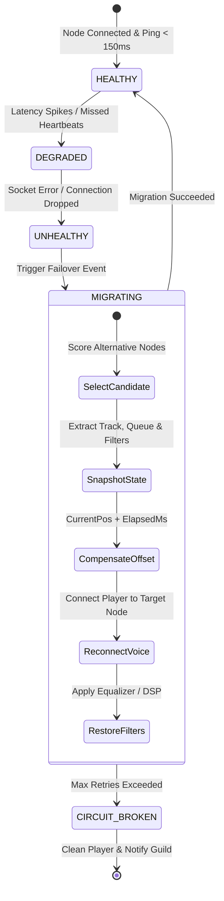
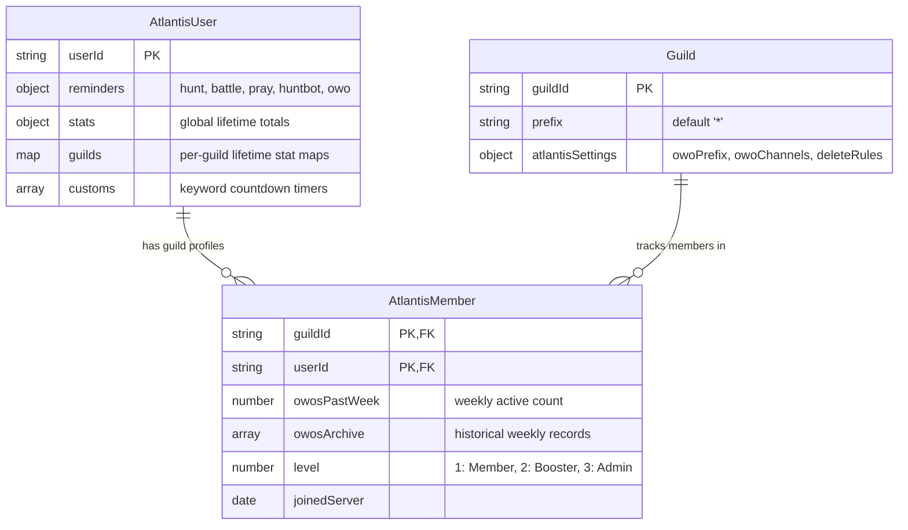
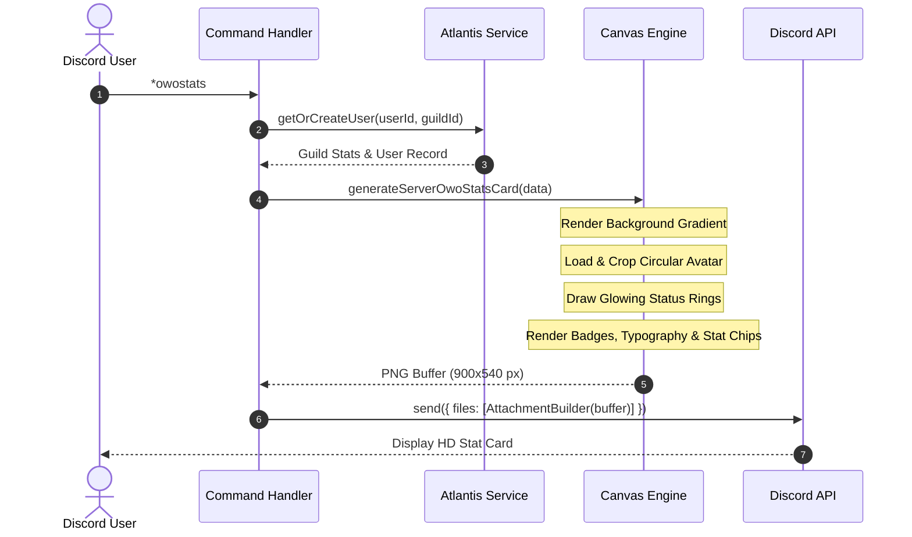

<div align="center">

# 🏛️ SYSTEM ARCHITECTURE & TECHNICAL SPECIFICATION
### Deep Architectural Dive into Ira Music & Atlantis Bot Engine

</div>

---

## 📌 Executive Summary

**Ira Music & Atlantis** is architected as an event-driven, high-concurrency micro-monolith designed to operate reliably across tens of thousands of Discord guilds. The platform is decoupled into three primary functional domains:
1. **Audio Streaming & Fault-Tolerant Failover Subsystem** (Lavalink v4, LavaSrc, DSP filters)
2. **Atlantis Multi-Server Community & Reminder Engine** (Scoped isolation, background cron triggers, automated weekly archiving)
3. **Observability, Web Administration & Canvas Rendering** (REST API, Prometheus metrics, hardware-accelerated canvas generation)

---

## 🏗️ High-Level System Architecture

```mermaid
graph TB
    subgraph Discord_Gateway ["Discord Gateway & Edge"]
        User["Discord User"]
        BotInstance["Discord.js v14 Client / Shard"]
    end

    subgraph Core_Pipeline ["Core Ingestion Pipeline"]
        MsgCreate["messageCreate Event"]
        CmdRouter{"Message Router"}
        PermEngine["Permission Engine & Rate Limiter"]
    end

    subgraph Music_Domain ["Audio Streaming Engine"]
        MusicCmds["Music Commands"]
        MusicService["Lavalink Client Manager"]
        FailoverMgr["Failover & Migration Manager"]
        NodeCluster[("Lavalink v4 Nodes\n(EU / US / ASIA)")]
    end

    subgraph Atlantis_Domain ["Atlantis Community Engine"]
        AtlantisListener["Atlantis Message Listener"]
        AutoMod["Channel Auto-Moderator"]
        ReminderEngine["OwO Reminder Scheduler"]
        StatsScoper["Multi-Server Stat Scoper"]
        WeeklyCron["Sunday 00:00 UTC Auto-Reset Cron"]
    end

    subgraph Data_Layer ["Persistence & Analytics"]
        MongoDB[("MongoDB Replica Set")]
        L1Cache["In-Memory Guild Cache"]
    end

    subgraph Presentation_Layer ["Presentation & Interfaces"]
        CanvasGen["Canvas Studio Engine"]
        WebDash["Express Dashboard (/members, /health)"]
    end

    User -->|Voice / Text| Discord_Gateway
    Discord_Gateway --> MsgCreate
    MsgCreate --> CmdRouter

    CmdRouter -->|Prefix '*' Command| PermEngine
    PermEngine --> MusicCmds
    MusicCmds --> MusicService
    MusicService --> NodeCluster
    NodeCluster -.->|Socket Failure| FailoverMgr
    FailoverMgr -->|Migrate Player| NodeCluster

    CmdRouter -->|Chat Triggers (owo, wh, wb)| AtlantisListener
    AtlantisListener --> AutoMod
    AtlantisListener --> ReminderEngine
    AtlantisListener --> StatsScoper

    WeeklyCron --> MongoDB
    StatsScoper --> MongoDB
    MusicService --> MongoDB
    L1Cache <--> MongoDB

    StatsScoper --> CanvasGen
    CanvasGen --> Discord_Gateway
    WebDash <--> MongoDB
```

---

## 🎵 Audio Streaming & Failover Subsystem

### 1. Multi-Lavalink Failover State Machine
When an active Lavalink node experiences network degradation or ungraceful termination, the `PlayerMigrationManager` executes a seamless recovery sequence:



### 2. Playback Position Compensation Formula
During cross-node migration, latency between disconnecting from Node A and streaming from Node B can cause audible repetition. The migration manager calculates:

$$\text{Effective Position} = \text{lastSavedPosition} + (\text{now} - \text{snapshotTimestamp})$$

If $\text{Effective Position} \ge \text{trackDuration}$, the manager immediately resolves and triggers the next track in the queue.

---

## 🏰 Atlantis Multi-Server Scoping Architecture

### 1. Guild Isolation via Compound Indices
Unlike traditional single-server bots, Atlantis isolates player progression per Discord server while maintaining global lifetime records:



- **Compound Index**: `{ guildId: 1, userId: 1 }` (Unique constraint strictly scoped per guild).
- **Leaderboard Aggregation**: The global view utilizes MongoDB `$group` on `userId` to aggregate `owosPastWeek` across all servers dynamically.
- **Auto-Reset Lifecycle**: Every Sunday at `00:00 UTC`, `atlantisService.weekReset(null)` transfers `owosPastWeek` into `owosArchive` with status tags (`✔️` for $\ge 50$ OwOs, `❌` otherwise) and resets weekly counts to zero with zero downtime.

---

## 🎨 Canvas Studio & Asset Pipeline

Card rendering uses native `@napi-rs/canvas` (Rust-backed Skia engine) for sub-millisecond execution times:



### Font Engine & Asset Caching:
- System fonts and bundled TTF/OTF files (`Segoe UI Emoji`, `Arial`, `Inter`) are pre-registered into the Skia font collection during client startup via `fontLoader.js`.
- Font descriptors are cached in-memory to prevent filesystem I/O on every command execution.

---

## 🛡️ Security Defenses

1. **IDOR & Guild Isolation**:
   - Web endpoints check authenticated OAuth2 Discord sessions against server permissions (`ManageGuild` or `Administrator`) before returning configuration data.
2. **Command Abuse & Rate Limiting**:
   - `commandAbuseProtection.js` tracks sliding execution windows per user, automatically imposing cooldowns when execution exceeds safe thresholds.
3. **Bot-Ban Enforcement**:
   - `BotBan` documents stored in MongoDB reject any interaction before commands or triggers are parsed.
4. **Auto-Moderation Sanitization**:
   - Channel deletion rules enforce strict message length boundaries and timeout unref to prevent memory leaks.

---

## 📊 Observability & Metrics

- **`/health`**: HTTP 200 liveness probe verifying process responsiveness.
- **`/ready`**: Verifies Discord WebSocket status, Lavalink cluster connectivity, and MongoDB connection pool state.
- **`/metrics`**: Exposes Prometheus-formatted metrics:
  - `discord_guild_count`
  - `discord_voice_players_active`
  - `process_cpu_seconds_total`
  - `process_resident_memory_bytes`
  - `atlantis_weekly_active_members`
