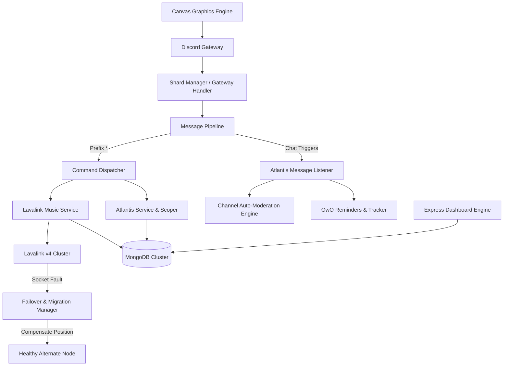

<div align="center">

# 🎵 IRA MUSIC & ATLANTIS
### Enterprise-Grade Global Discord Music & Community Engine

[](https://nodejs.org/)
[](https://discord.js.org/)
[](https://github.com/lavalink-devs/Lavalink)
[](https://www.mongodb.com/)
[](https://github.com/Brooooooklyn/canvas)
[](https://jestjs.io/)
[](LICENSE)

<p align="center">
  <b>A high-performance Discord music platform and community automation bot featuring zero-downtime playback recovery, multi-node Lavalink clustering, an isolated multi-server OwO tracker, automated weekly leaderboards, customizable greeting canvases, and a sleek web dashboard.</b>
</p>

[Key Features](#-key-features) • [Quick Start](#-quick-start) • [Commands](#-available-commands) • [Web Dashboard](#-web-dashboard) • [Architecture](#-architecture--failover) • [Contributing](#-contributing)

---

</div>

## 🌟 Overview

**Ira Music & Atlantis** bridges the gap between audiophile-grade music streaming and dynamic server engagement. Built from the ground up for high concurrency, it handles thousands of voice connections, real-time audio filtering, and community game triggers simultaneously across multiple Discord servers.

```
       ┌────────────────────────────────────────────────────────┐
       │                IRA MUSIC & ATLANTIS                    │
       ├──────────────────────────┬─────────────────────────────┤
       │   🎵 High-Fi Audio Engine│  🏰 Atlantis Community Hub  │
       │   • Multi-Lavalink v4    │  • Multi-Server OwO Reminders│
       │   • Zero-Downtime Failover│ • Per-Server Game Stats    │
       │   • 24/7 Voice & Autoplay│  • Auto Sunday UTC Reset    │
       │   • Audio Filters (8D/EQ)│  • HD Canvas Stat Cards     │
       ├──────────────────────────┴─────────────────────────────┤
       │   🌐 Real-time Web Dashboard (OAuth2 + Live Management)│
       │   🖼️ Greeting Card Studio (Canvas Welcome / Leave)     │
       │   🛡️ Production Security (Rate Limits, Auto-Mod, Bans)  │
       └────────────────────────────────────────────────────────┘
```

---

## ⚡ Key Features

### 🎧 High-Fidelity Music Streaming
- **Multi-Source Track Resolution**: Seamlessly stream from YouTube, YouTube Music, SoundCloud, and Spotify (via LavaSrc).
- **Cluster Failover & Session Recovery**: Automated heartbeat monitoring migrates active voice players to alternate Lavalink nodes upon network faults with exact millisecond position compensation.
- **Studio DSP Audio Filters**: Bassboost, Nightcore, Vaporwave, 8D rotation, and Pop Equalizers with zero audio stutter.
- **Autoplay & Smart Suggestions**: Autonomous recommendation engine enqueues matching tracks when queues run dry.
- **Custom Playlists**: Create, save, browse, and play cloud-synchronized playlists directly from Discord.

### 🏰 Atlantis & OwO Community Hub
- **Isolated Multi-Server Scoping**: Individual players maintain independent statistics (`hunt`, `battle`, `owo`, `pray`) across different Discord servers without cross-contamination.
- **Compact Shorthand Recognition**: Instant detection for compact OwO shortcuts (`wh`, `wb`, `wp`, `wc`) and custom server prefixes.
- **High-Definition Canvas Cards**: Dynamic $900 \times 540$ px luxury canvas cards for `*owostats` and `*serverstats` featuring glowing avatar rings, rank chips, and huntbot timers.
- **Automated Sunday Reset**: Built-in background cron automatically closes and archives weekly leaderboards every Sunday at `00:00 UTC`.
- **Smart Huntbot Tracking**: Auto-detects OwO bot responses (`BEEP BOOP`), logging huntbot completion timestamps and duration.

### 🖼️ Greeting Card Engine & Dashboard
- **Live Canvas Welcome / Leave**: Customizable server greeting cards rendered in hardware-accelerated Canvas with avatar frames, badges, and typography controls.
- **Full-Featured Web Dashboard**: View active guild audio queues, manage custom greeting banners, and browse global and per-server `/members` leaderboards.

---

## 🚀 Quick Start

### Prerequisites
- **Node.js**: `v18.0.0` or higher
- **MongoDB**: `v6.0+` (Local or MongoDB Atlas)
- **Lavalink**: `v4.x` node server with `LavaSrc` & `YouTube` plugins

### 1. Clone Repository
```bash
git clone https://github.com/oyy-gus/ira-music.git
cd ira-music
```

### 2. Install Dependencies
```bash
npm install
```

### 3. Configure Environment
Copy the sample environment file and configure your credentials:
```bash
cp .env.example .env
```
Fill in your credentials in `.env`:
```env
DISCORD_TOKEN=your_bot_token_here
DISCORD_CLIENT_ID=your_client_id_here
DISCORD_CLIENT_SECRET=your_client_secret_here
OWNER_ID=your_discord_user_id
MONGODB_URI=mongodb://127.0.0.1:27017/ira-music
LAVALINK_NODES=[{"id":"main-node","host":"127.0.0.1","port":2333,"authorization":"youshallnotpass","secure":false}]
```

### 4. Run the Bot
```bash
# Production mode
npm start

# Development mode (Hot-reload)
npm run dev

# Multi-process sharding (for 2,500+ servers)
npm run start:sharded
```

---

## 📋 Available Commands

Default prefix: `*` *(configurable per-server using `*prefix <new>`)*.

### 🎵 Music Commands
| Command | Aliases | Description |
|---|---|---|
| `*play <query>` | `*p` | Play audio or playlist from YouTube, Spotify, or SoundCloud |
| `*search <query>` | `*find` | Search tracks with an interactive selector menu |
| `*pause` / `*resume` | — | Pause or resume playback |
| `*skip` | `*s`, `*next` | Skip to the next track in queue |
| `*stop` | `*dc`, `*disconnect` | Stop playback, clear queue, and leave voice channel |
| `*nowplaying` | `*np` | Display interactive track player with button controls |
| `*queue [page]` | `*q` | View current and upcoming tracks with pagination |
| `*volume <1-150>` | `*vol`, `*v` | View or adjust playback volume |
| `*seek <time>` | — | Seek to specific timestamp (`mm:ss` or seconds) |
| `*filter <type>` | `*eq` | Apply filters: `bassboost`, `nightcore`, `vaporwave`, `8d`, `pop`, `reset` |
| `*autoplay` | `*auto` | Toggle autonomous smart song recommendations |
| `*247` | `*24/7`, `*stay` | Keep bot connected in voice channel indefinitely |
| `*playlist` | `*pl` | Create, add, delete, view, or stream custom personal playlists |
| `*profile [@user]` | `*user` | View dynamic Canvas-rendered music profile & listening stats |

### 🔔 Game & OwO Reminders
| Command | Aliases | Description |
|---|---|---|
| `*hunt [on/off]` | `*catch`, `*owohunt` | Toggle reminder notification for `owo hunt` / `wh` (15s) |
| `*battle [on/off]` | `*b`, `*fight` | Toggle reminder notification for `owo battle` / `wb` (15s) |
| `*praycurse [on/off]` | `*pray`, `*curse` | Toggle reminder notification for `owo pray` / `curse` (5m) |
| `*huntbot [on/off]` | `*hb` | Toggle reminder when your HuntBot expedition completes |
| `*owo [on/off]` | `*uwu` | Toggle reminder for typing `owo` / `uwu` (10s) |
| `*custom` | `*timer` | Manage custom phrase and keyword countdown timers |
| `*show` | `*reminders` | View the status of all your reminder toggles |

### 📊 Utility & Stats
| Command | Aliases | Description |
|---|---|---|
| `*owostats [@user]` | `*ostats`, `*owos` | View HD Canvas OwO stats card (Server-isolated or `global`) |
| `*serverstats` | `*guildstats` | View HD Canvas server-wide OwO activity & top leaderboard |
| `*owotop [global]` | `*otop` | View weekly OwO leaderboard for this server or globally |
| `*zoostats [@user]` | `*zoo` | Calculate and display player OwO zoo animal counts & points |
| `*help [command]` | `*h`, `*commands` | Browse command categories and detailed usage guides |
| `*stats` | `*botinfo`, `*bi` | Display bot system specs, uptime, memory, and cluster health |
| `*ping` | `*latency` | Inspect bot latency and Discord Gateway heartbeat |

### 🛡️ Administration & Developer Tools
| Command | Category | Description |
|---|---|---|
| `*owoprefix <prefix>` | Admin | Configure custom OwO bot prefix used for reminder triggers |
| `*owochannel <#ch>` | Admin | Restrict channel to `owo`/`uwu` messages only |
| `*delbot <#ch>` | Admin | Auto-delete bot responses in designated channels |
| `*deluser <#ch>` | Admin | Auto-delete user trigger commands in designated channels |
| `*delete <word>` | Admin | Add custom prefix/word deletion rules for designated channels |
| `*eval <code>` | Developer | Execute arbitrary JavaScript code in runtime context |
| `*botban <@user>` | Developer | Ban or unban abusive users from interacting with the bot |
| `*resetstats <@user>` | Developer | Reset an individual user's OwO statistics across guilds |
| `*reload <module>` | Developer | Hot-reload commands or event handlers without rebooting |
| `*shutdown` | Developer | Safely disconnect players, flush database, and stop process |

---

## 🌐 Web Dashboard

The bot bundles an Express HTTP dashboard serving real-time statistics and management tools:
- **`GET /`**: Server hub and status overview
- **`GET /members`**: Interactive weekly OwO leaderboard with per-server filtering (`?guildId=<id>`)
- **`GET /members/:id`**: Detailed member card with historical weekly archive charts
- **`GET /health`** & **`GET /ready`**: Liveness and readiness probes for Docker / Kubernetes
- **`GET /metrics`**: Prometheus-compatible metrics stream

---

## 🏛 Architecture & Failover



---

## 🧪 Testing

The repository includes a comprehensive unit and integration test suite running on **Jest**:

```bash
# Run all test suites
npm test

# Run tests with coverage report
npm test -- --coverage
```

```
Test Suites: 8 passed, 8 total
Tests:       54 passed, 54 total
Snapshots:   0 total
Time:        4.026 s
```

---

## 📄 License

This project is licensed under the [ISC License](LICENSE).
Feel free to fork, adapt, and build upon this platform!
