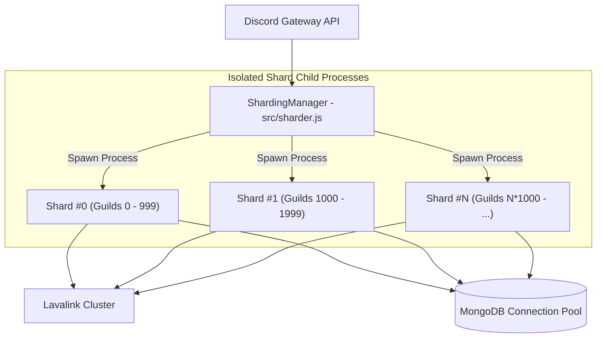
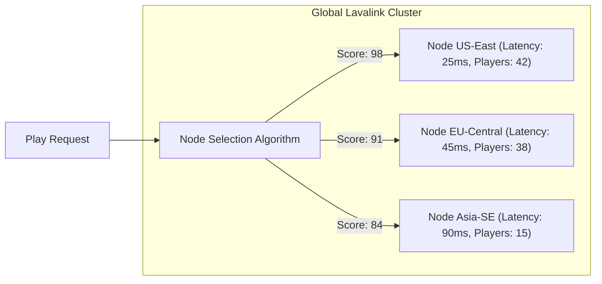

<div align="center">

# ⚡ SCALING & HIGH-AVAILABILITY BLUEPRINT
### Architecture for 10,000+ Discord Guilds & Enterprise Load

</div>

---

## 🌐 Discord Gateway Sharding Strategy

Discord limits a single gateway connection to approximately 2,500 guilds. Beyond this threshold, process-level sharding is required to distribute CPU load and prevent WebSocket event starvation.



### Launching Sharded Cluster:
```bash
node src/sharder.js
```
- **Auto Shard Calculation**: Queries Discord Gateway `/gateway/bot` to retrieve recommended shard count dynamically.
- **Process Supervision**: Child shard processes that exit unexpectedly are automatically revived with sequential stagger to avoid Discord API burst rate limits (`5 seconds` between shard logins).
- **Cross-Shard Messaging**: Evaluates cluster-wide statistics via `client.shard.broadcastEval()`.

---

## 🔊 Lavalink Multi-Node Geographic Load Balancing

The bot distributes audio players across multiple independent Lavalink nodes defined in `LAVALINK_NODES`:



### Candidate Scoring Function:
When a voice player is created, candidate nodes are evaluated based on weighted metrics:

$$\text{Score} = 100 - (\text{Ping} \times 0.25) - (\text{CPU} \% \times 0.35) - (\text{PlayerCount} \times 0.15)$$

- Nodes in `DEGRADED` or `DRAINING` states are automatically excluded from scoring.
- If a node drops, the `PlayerMigrationManager` executes atomic migration with playback offset correction.

---

## 🗄️ Database Optimization & Scaling

### 1. Compound Indexing Architecture
All frequent read/write paths leverage specialized MongoDB compound indices to maintain $O(\log N)$ query times even with millions of records:

| Collection | Index | Purpose |
|---|---|---|
| `atlantismembers` | `{ guildId: 1, userId: 1 }` (Unique) | Instant per-server user lookup & upsert |
| `atlantismembers` | `{ guildId: 1, owosPastWeek: -1 }` | Fast server leaderboard sorting without in-memory sort |
| `atlantisusers` | `{ userId: 1 }` (Unique) | Lifetime global user statistics retrieval |
| `guilds` | `{ guildId: 1 }` (Unique) | Fast guild settings and prefix resolution |

### 2. Multi-Level Caching (L1 In-Memory + DB)
- **Guild Configuration**: Frequently queried guild settings (prefix, auto-delete rules, owo channel) are cached in memory via `guildRepository.js` with a 10-minute TTL.
- **Debounced Session Sync**: During active playback, player position snapshots are held in memory and debounced before persisting to MongoDB, preventing database I/O thrashing during seeks or volume adjustments.

---

## 🖼️ High-Throughput Canvas Rendering

Generating graphic cards on demand (like `*owostats` and `*profile`) can be CPU-intensive if unoptimized. Our implementation utilizes:

1. **Pre-Loaded Font Glyphs**: Font descriptors are loaded once at startup and registered directly into Skia's native font registry, eliminating disk reads per render.
2. **Avatar Pre-Fetching with Timeout**: Avatars are fetched with an aggressive 3-second timeout and fallback silhouette to prevent hanging rendering threads.
3. **Offscreen Buffer Memory Pools**: Avoids intermediate file writes to disk; buffers are directly wrapped in `discord.js` `AttachmentBuilder` memory streams.

---

## 🛡️ Resilience & Self-Healing Safeguards

- **Circuit Breakers**: Repeated failures on external APIs (Spotify LavaSrc, YouTube stream endpoints) open circuit breakers to fail fast and preserve worker event loops.
- **Anti-Migration Loop Protection**: If a specific guild experiences more than 3 node migrations within 60 seconds, migration is halted and a notification is dispatched to prevent cascade degradation.
- **Auto-Delete Memory Safety**: All `setTimeout` cleanup handlers for self-deleting message embeds invoke `.unref()` so background timers do not prevent graceful garbage collection.
